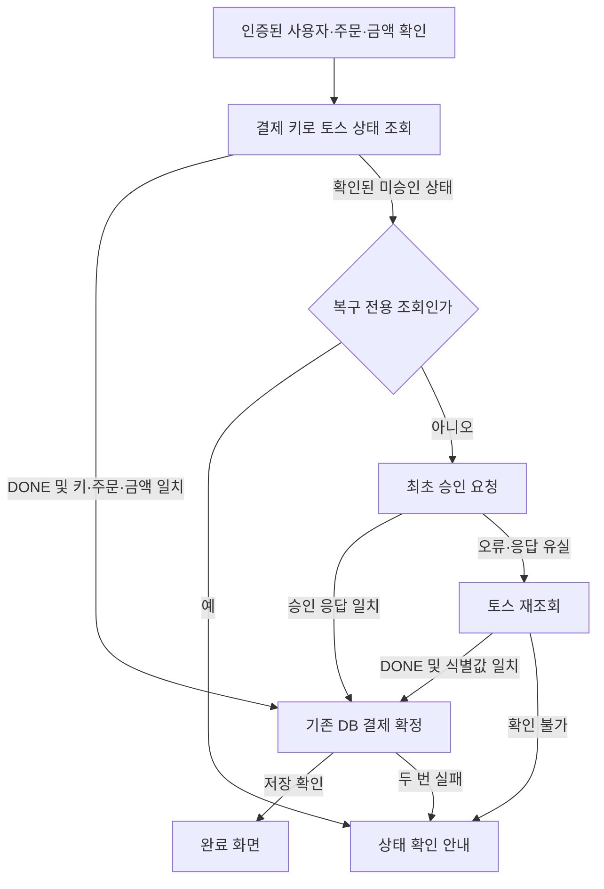

# 토스 결제창형 테스트 연동

기록일: 2026-10-31 KST. 추적 이슈: [#152](https://github.com/whatukknow/Shoppingmall/issues/152), [보안 패치 #153](https://github.com/whatukknow/Shoppingmall/issues/153).

## 선택한 방식과 화면 보존

기존 주문서의 배송 정보·요약·이미지·배치를 유지한다. 사용자가 지정한 기존 Toss Pay 타일은 같은 자리에 실제 버튼으로 연결하고, 카드 선택과 하단 Pay 흐름도 유지한다. 기존 `payment()` 연동은 공식 문서에서 결제창(구버전)으로 구분한다.

신규 흐름은 `widgets()` → `setAmount()` → `renderPaymentWindow()` → `paymentRequest` 이벤트 → `requestPayment()`이다. SDK 2.10.0에 해당 타입이 있으므로 토스 SDK 버전을 바꾸지 않았다. 입력 금액은 서버가 생성한 주문 금액을 사용하고, 콜백은 현재 접속 주소를 기준으로 만든다. HTTP 주소의 실제 결제 완주 여부는 브라우저 검증 결과와 구분한다.

사용 키는 주문서형·결제창형의 `gck`·`gsk`이며 두 키의 테스트/라이브 환경이 일치해야 한다. 시크릿 키는 서버 전용이다. 실제 키 값과 환경 파일은 저장소·PR·검토 자료에 포함하지 않는다.

## 코드 작성과 연결 순서

1. `domains/payment/pg-toss/toss.configuration.ts`에서 키 종류와 환경을 검사한다. `data/payment.create-order.ts`는 수량·양수 가격·총액을 검증한 뒤에만 기존 주문 RPC를 호출한다.
2. `pg-toss/requestTossPayment.ts`는 브라우저 SDK를 연결한다. `pg-toss/tossPaymentWindow.ts`는 테스트용 SDK 주입이 가능한 결제창 제어기로 금액 설정·창 생성·이벤트·취소·정리를 담당한다.
3. `components/PaymentPage.tsx`의 공통 `beginCheckout(selectedMethod)`는 기존 Toss Pay 자리의 직접 실행과 카드·하단 Pay 흐름에서 배송·동의·선택 팟·키를 검사한다. 클릭한 수단을 명시적으로 전달해 이전 state를 참조하지 않고, 동시 제출과 창 세션 전체를 잠근다. 언마운트 시 진행 중인 세션을 중단한다. 창이 늦게 만들어져도 소유한 창만 정리한다.
4. `pg-toss/toss.service.ts`와 `payment.actions.ts`는 토스 조회·승인과 기존 Supabase 주문 확정의 경계를 처리한다.
5. `pay-completed`·`pay-failed` 페이지와 `PaymentResultPage.tsx`가 완료·실패·확인 필요 상태를 표시한다. 정상 화면의 기존 스타일과 구성은 보존한다.

신규 SDK는 사이트 라디오의 결제수단을 결제창에 미리 선택하는 인자를 제공하지 않는다. 기존 카드·토스페이 선택은 유지하되, 토스 창에서 실제 선택한 수단과 금액이 일치할 때만 요청한다. 계좌이체·가상계좌·휴대폰·브랜드페이·해외결제·커스텀 수단을 자동으로 지원 범위에 추가하지 않는다. 불일치하면 승인 요청 전에 창을 정리하고 안내한다.

## 승인·저장 실패 처리

콜백은 먼저 `paymentKey`로 토스 상태를 조회한다. 검증된 DONE이면 승인 POST를 반복하지 않고 기존 DB 확정을 재시도한다. 정상 최초 흐름에서 명시적인 `NOT_FOUND_PAYMENT` 404 또는 주문과 식별값이 일치하는 READY·IN_PROGRESS 상태가 확인됐을 때만 승인 요청으로 진행한다.

승인 응답이 유실되거나 오류가 나면 토스를 한 번 재조회한다. 키·주문·금액·DONE이 확인되지 않으면 확인 필요 상태를 반환한다. 토스 승인 후 DB 반영이 두 번 모두 실패해도 성공으로 표시하지 않는다.

복구 화면의 같은 결제 상태 확인 링크에는 `recovery=1`이 붙으며 이 경로는 승인 POST를 하지 않는다. 승인 여부가 불확실한 상태에는 새 결제 재시도 링크를 제공하지 않는다. 취소가 확인된 기존 실패 화면의 재시도 동선은 유지한다.

## 검증 상태

- 변경 전 문제: 승인 후 DB 저장 실패를 삼킨 성공 응답과 완료 페이지의 pending 재조회가 어긋났다. 해당 경로를 모의 검사로 재현하고 명시적인 복구 상태로 변경했다.
- 최초 구현 347개에 Toss Pay 직접 실행 회귀 4개를 추가한 최종 전체 합성 검사는 351개·61개 모음, 실패 0이다. 그 안에 결제창·실제 페이지 소스의 주입 검사 25개가 포함된다. 별도 복구 화면·영수증 SSR 단언 8개도 독립 검수에서 통과했다. 기본 로고·그리드·타일 크기·색·선택 테두리를 유지하고 사용자 승인에 따라 타일 태그·핸들러·props를 변경했다.
- 실제 Claude Code CLI: 2026-10-31 09:02:40~09:05:32 KST, 172.79초, 종료 0. 소스·테스트 14개를 정적으로 검토했으며 확정된 P0·P1·P2 소견은 없었다. 이 초기 정적 검토 자체에는 실제 승인·DB 저장·iOS의 성공 판정이 포함되지 않는다. 이후 버튼·의존성 변경의 추가 검토 실행 증거는 PR 검증 기록에 명시한다.
- 공식 공개 샘플 테스트 키의 서버 읽기 전용 조회: 예상한 `404 NOT_FOUND_PAYMENT` 확인. 실제 승인 요청은 이 조회에 포함되지 않는다.
- 기존 두 테스트 계정의 생성·참여로 2인 팟을 결제 준비 상태로 만들었다. 실제 Toss Pay 테스트 승인 시각은 09:15:55 KST이고, 이후 공식 토스 GET에서 DONE·간편결제/토스페이·4900원·주문과 결제 키 일치를 확인했다. 개인정보·식별자는 결과 기록에서 제외했다.
- 실제 Supabase SELECT와 REST 읽기에서 본인 주문 paid·4900원, 배송비3000원, 상품1개/1900원, 참여자의 paid_at과 같은 paid_order_id를 확인했다. 팟은 활성 참여자2명 중1명 결제 상태이며 두 사람 모두 결제한 상태로 주장하지 않는다.
- 별도 새 문서와 실제 새로고침에서도 완료·금액·영수증 링크가 유지됐다.
- 최종 16.4.1·버튼 구현의 프로덕션 빌드가 종료0으로 통과했다.

### 로컬 읽기 전용 장애 복귀 시연

최종 빌드를 별도 로컬 서버에서 실행하고, 이미 PAID인 같은 테스트 주문의 `recovery=1` 경로만 사용했다. 서버의 토스 결제 상태 GET에 일시503을 주입하자 확인 필요 화면과 상태 확인 링크가 표시됐고 새 결제 링크는 없었다. 주입을 해제한 뒤 상태 확인으로 완료·4900원·영수증 화면으로 돌아왔다.

관측 통계는 주입 조회 실패4회, 해제 후 실제 조회 전달1회, 제공자 쓰기 및 Supabase REST 쓰기 시도0회이다. 리허설 장치는 해당 로컬 프로세스의 fetch에 적용되고 쓰기를 차단했다. 이는 브라우저 SDK 전체의 방화벽이나 다중 프로세스 전역 감사 증거가 아니다. 기존 DB PAID를 되돌리거나 운영 서비스를 중단하지 않았으며, 실제 운영 롤백을 시연한 것으로 해석하지 않는다. 시연 후 장애 주입을 제거했다.

## 보안 패치와 배포 조건

검증 서버 시작 중 Next.js 16.4.0의 보안 권고를 확인했다. 공식 npm advisory와 GitHub 공지의 영향 범위에 포함되며 수정 버전은 16.4.1이다. `next`와 `eslint-config-next` 및 해당 lock 항목만 최소 패치했다. 다른 작업 트리와 운영 서버의 의존성을 이 단계에서 바꾸지 않았다. 16.4.1에 대한 동일 npm 조회는 해당 Next 권고 0건이었다. 특정 공격 재현이나 침해 여부를 확인한 결과는 아니다.

모든 변경은 PR·독립 검수·Claude Code 교차검토 뒤 사람이 머지한다. 운영 배포는 머지 확인 후 수행한다. 이 결제 변경에서는 Supabase 스키마·권한·상품 가격을 변경하지 않는다. 별도 상품 가격 작업은 이 PR에 포함하지 않는다.

## 남는 경계

- DB에 새 결제 불확실 상태나 결제 키 저장 컬럼을 추가하지 않았다. 복구는 콜백의 결제 정보와 토스 조회에 의존한다.
- 서로 다른 주문의 동시 승인·SQL 원자성·전역 중복 청구 방지는 이번 코드와 모의 검사만으로 보장하지 않는다.
- 실제 iOS Safari·시뮬레이터·bfcache 복원과 종료되지 않는 SDK 호출은 별도 실행 증거가 필요하다.
- 운영 릴리스 롤백은 결제 데이터 복구와 별개이다. 앞선 복귀 합성 검사 6건을 실제 운영 롤백 성공으로 해석하지 않는다.

## 근거

- [신규 결제창형 연동 가이드](https://docs.tosspayments.com/guides/v2/payment-widget/integration-window)
- [결제창형 SDK 상세](https://docs.tosspayments.com/sdk/v2/js/payment-window)
- [API 키 종류](https://docs.tosspayments.com/reference/using-api/api-keys)
- [토스 테스트 환경](https://docs.tosspayments.com/guides/v2/get-started/environment)
- [공식 공개 샘플](https://github.com/tosspayments/tosspayments-sample)
- [SVG 이미지 최적화 보안 권고](https://github.com/advisories/GHSA-2464-fhr4-w9xw)
- [캐시 함수 보안 권고](https://github.com/advisories/GHSA-673q-mjm6-r5xr)
- [Server Actions 보안 권고](https://github.com/advisories/GHSA-p3m5-59mp-jv5r)
