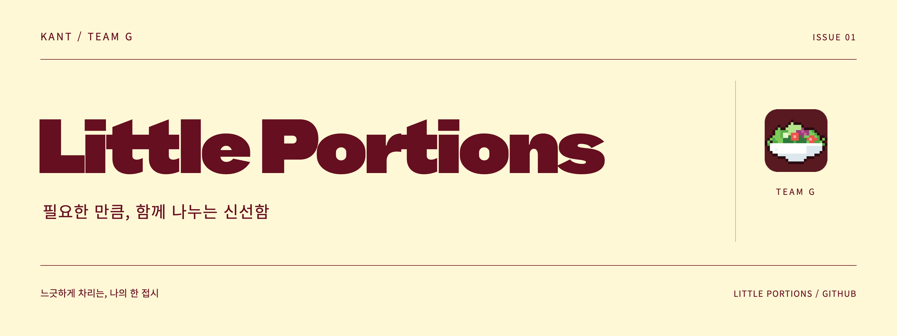
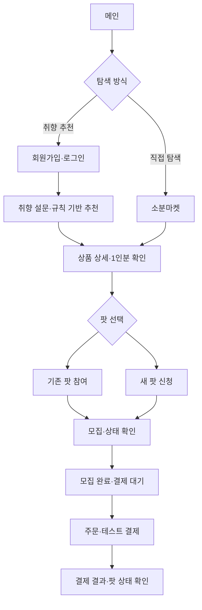
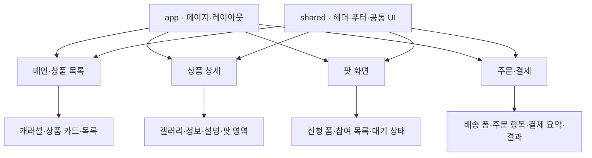
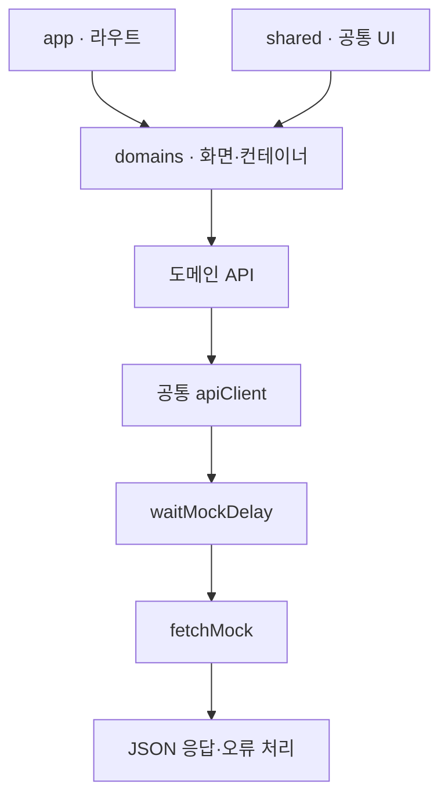
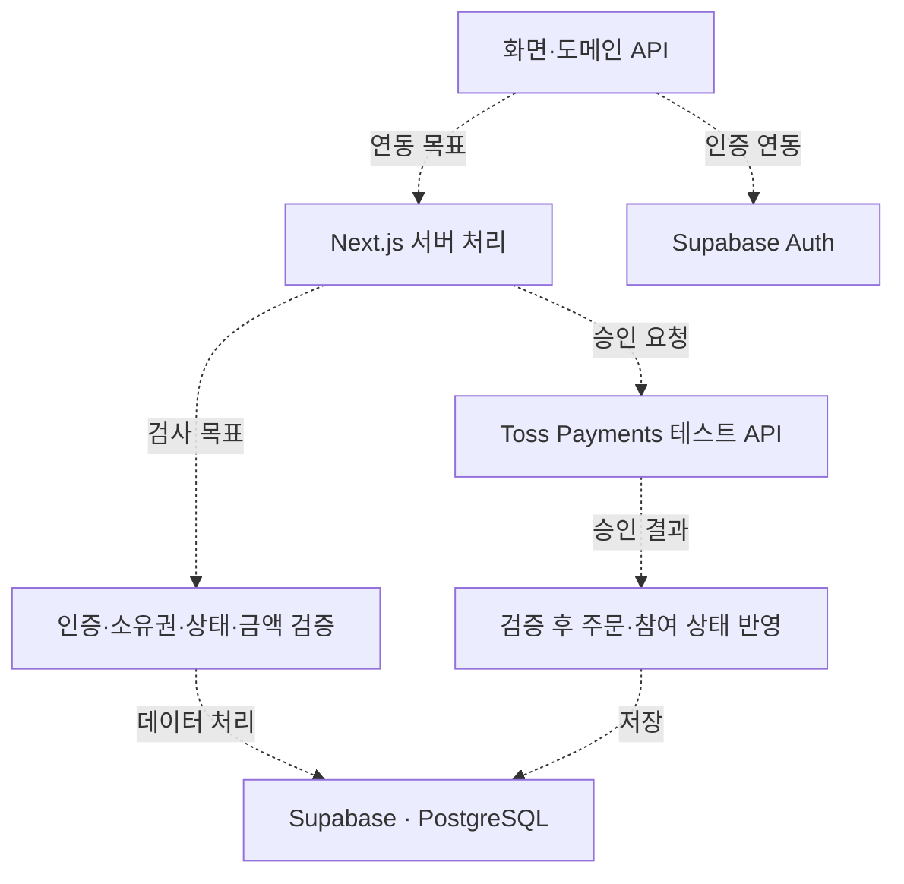
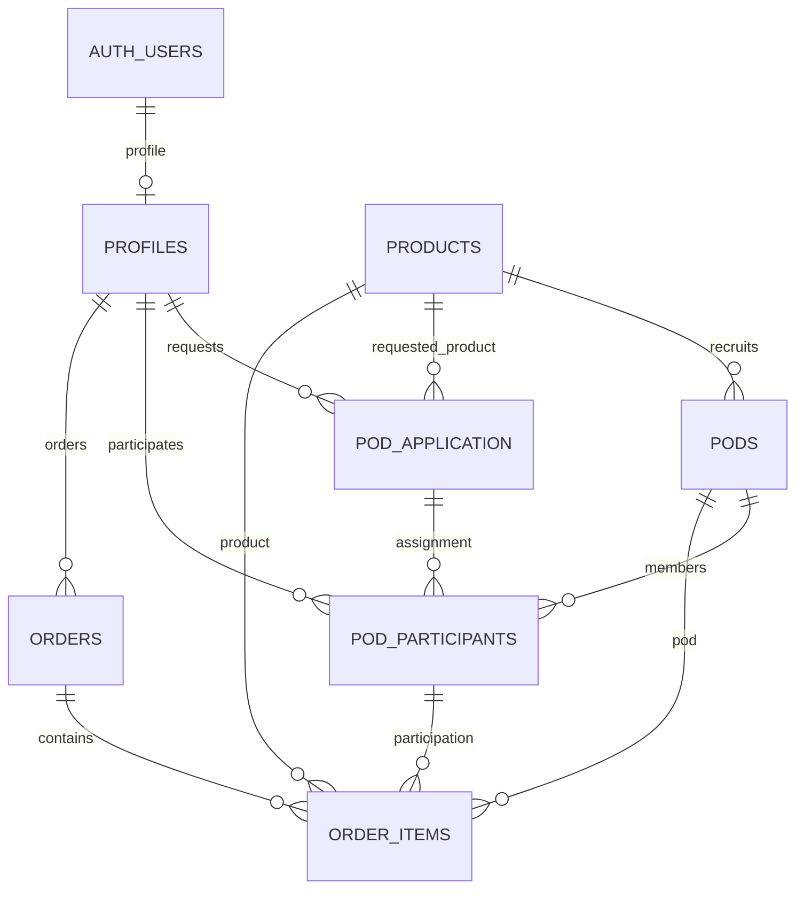
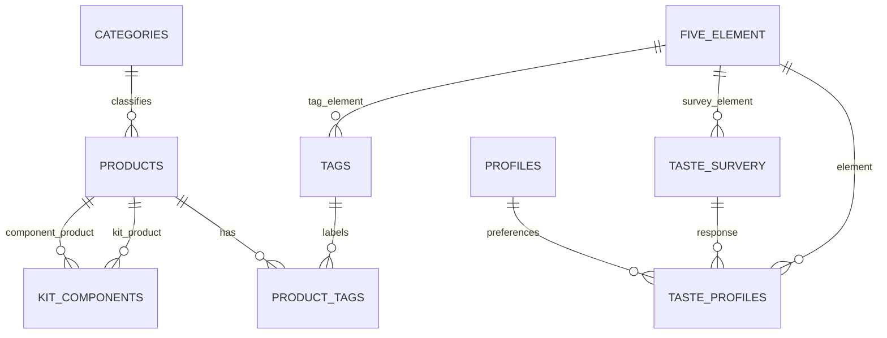
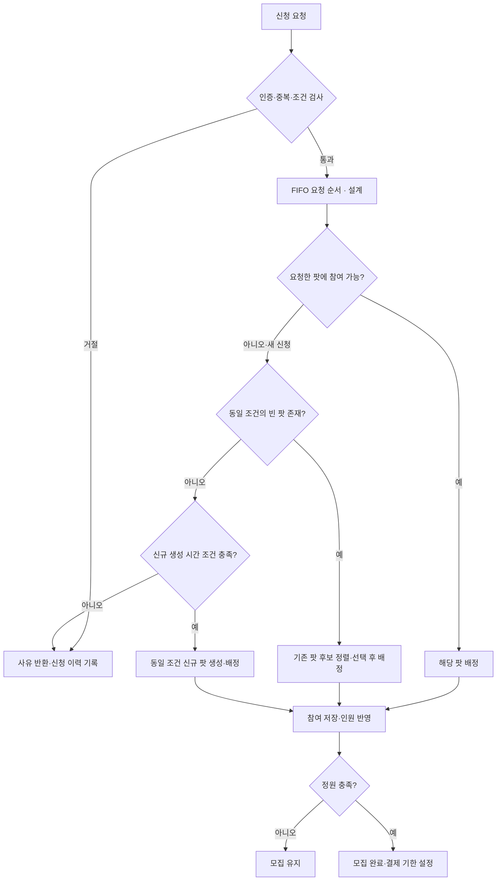
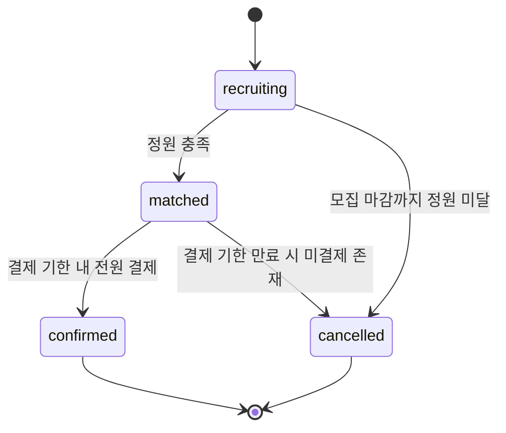

# Little Portions | 리틀포션스

**1~2인 가구의 취향과 라이프스타일에 맞춰 필요한 만큼의 신선한 식재료를 제안하는 맞춤형 소분 식료품 큐레이션 쇼핑몰입니다.**



취향 찾기로 식재료를 추천받고, 공동구매 모임인 ‘팟’을 통해 필요한 만큼 구매하는 경험을 제공합니다.

- **팀명:** 우리가짱이조
- **개발 기간:** 2026.10.13 ~ 2026.10.23
- **배포:** AWS EC2 배포 예정 · 공개 주소 미제공
- **시연 자료:** 실제 화면 캡처·영상 미첨부

## 주요 기능과 진행 상태

아래 상태는 **화면·시연 작업과 외부 서비스 연동을 구분**한 것입니다. 화면 파일·SDK가 있다는 사실만으로 기능 전체가 검증되었다고 표시하지 않았습니다.

| 기능                       | 화면·시연 범위                                                  | 연동·검증 상태                                                    |
| -------------------------- | --------------------------------------------------------------- | ----------------------------------------------------------------- |
| 회원가입·로그인·회원페이지 | 이메일 인증 및 회원정보 화면 구성                               | Supabase Auth·세션·복귀 흐름의 최종 검증 필요                     |
| 메인·상품 목록·상세        | 세 개의 캐러셀, 품목 탐색, 농장·작물·1인분 정보 및 활용 팁 화면 | 공통 클라이언트의 목업 경로 확인, 실제 데이터 연동 범위 확인 필요 |
| 취향 찾기                  | 픽셀 캐릭터·단계별 설문과 규칙 기반 추천 시연                   | 실제 AI 모델 미사용, 응답 저장·추천 결과 연결 최종 검증 필요      |
| 팟 신청·참여·상태 확인     | 기존 팟 참여, 새 팟 신청 및 상태별 행동 화면                    | 배정·중복·정원·시간 조건의 서버 동작 검증 필요                    |
| 주문·결제 결과             | 배송 정보, 결제 요청, 완료·실패 화면 및 Toss 테스트 연동 작업   | SDK 의존성 확인, 승인·DB 반영 E2E 검증 필요                       |
| 브랜드 이야기              | 서비스 문제의식과 브랜드 메시지 화면                            | 최종 화면 확인 필요                                               |

- **정적 확인:** `package.json`의 스크립트·의존성, 공통 `apiClient → fetchMock` 경로.
- **팀 작업 현황:** Supabase 연동 및 Next.js 서버의 프로필·팟·주문 처리 작업 진행 중.
- **설계 정책:** 자동 배정·기한 만료·전체 취소·환불 필요 대상 식별. 자동 실행과 실제 환불은 별도 검증 대상.
- **현재 제한:** 카테고리별 대표 상품 중심, 실제 AI 모델 미사용, 테스트 결제 환경.
- **실행 결과:** 이 문서 수정 과정에서는 테스트·빌드·구매 전체 흐름을 실행하지 않았습니다.

## 사용자 흐름

취향 추천 또는 직접 탐색으로 상품을 고른 뒤, 팟 모집과 결제를 거칩니다. 로그인과 최종 연동 동작은 검증 결과와 함께 확인합니다.



## 기술 스택

### 화면 개발


버전은 `package.json`의 선언 기준입니다. TypeScript `^5`와 Tailwind CSS `^4`는 버전 범위이며 실제 설치된 세부 버전을 뜻하지 않습니다.

### 데이터·외부 서비스


- Supabase의 최종 연동 범위는 확인 중입니다. SDK 패키지 미등록만으로 API 미사용을 의미하지 않습니다.
- 주소 검색 API 연동 작업을 진행했으며, 공식 서비스명과 최종 동작은 확인이 필요합니다.
- AWS EC2는 배포 예정 환경입니다.

### 품질 관리


## 실행 방법

### 1. 실행 환경

- Node.js: 팀에서 실행을 확인한 버전 미기록. `@types/node`의 버전은 런타임 요구 버전이 아닙니다.
- 패키지 매니저: npm

### 2. 저장소 복제 및 패키지 설치

```bash
git clone https://github.com/whatukknow/Shoppingmall.git
cd Shoppingmall
npm install
```

### 3. 환경변수 설정

프로젝트 루트에 `.env.local` 파일을 만들고 각 환경에 맞는 값을 입력합니다. 아래 값은 형식을 보여주기 위한 예시입니다.

```dotenv
NEXT_PUBLIC_SUPABASE_URL=YOUR_SUPABASE_URL
NEXT_PUBLIC_SUPABASE_PUBLISHABLE_KEY=YOUR_SUPABASE_PUBLISHABLE_KEY
SUPABASE_SECRET_KEY=YOUR_SUPABASE_SECRET_KEY
NEXT_PUBLIC_TOSS_CLIENT_KEY=YOUR_TOSS_TEST_CLIENT_KEY
TOSS_SECRET_KEY=YOUR_TOSS_TEST_SECRET_KEY
```

`SUPABASE_SECRET_KEY`와 `TOSS_SECRET_KEY`는 서버에서만 사용합니다. 실제 키가 포함된 `.env.local` 파일은 커밋하지 않습니다.

- DB 준비: 팀의 최종 테이블·초기 데이터 설정이 필요하며, 재현 가능한 초기화 절차는 아직 문서화되지 않았습니다.
- 미디어 준비: `/uploads/`는 `.gitignore`에 포함되어 있어 저장소 복제만으로 팀의 이미지·영상이 준비되지 않을 수 있습니다. 팀에서 제공하는 미디어와 실제 로컬·배포 배치 경로를 확인해야 합니다.
- 추가 설정: 주소 검색 등 외부 서비스의 추가 키·도메인 설정 여부는 최종 코드 기준 확인이 필요합니다.

### 4. 개발 서버 실행

```bash
npm run dev
```

브라우저에서 http://localhost:3000 에 접속합니다.

### 5. 테스트 및 빌드

```bash
# 기존 테스트 실행
npm run test

# 프로덕션 빌드
npm run build
```

현재 `package.json`에는 빌드 전에 테스트를 실행하는 `prebuild` 스크립트가 등록되어 있습니다.

| 검사   | 명령어          | 최종 결과               |
| ------ | --------------- | ----------------------- |
| 테스트 | `npm run test`  | 미실행 — 통과 주장 없음 |
| 린트   | `npm run lint`  | 미실행 — 통과 주장 없음 |
| 빌드   | `npm run build` | 미실행 — 통과 주장 없음 |

스크립트 등록을 정적으로 확인한 결과이며, 팀의 별도 실행 기록을 대체하지 않습니다.

## 팀원 및 역할

페이지별 주 담당자를 정해 작업했으며, 기획·데이터 설계와 후반 연동·수정은 공동으로 진행했습니다. 아래 역할·화면 배정은 이번 대화의 팀 설명을 기준으로 하며, 과거 발표 원고보다 우선합니다. PR 작성자·실명 매핑을 통한 기여도 검증이나 기여율 산정은 하지 않았습니다.

| 이름   | 팀 역할 | 주요 역할                                                          | GitHub |
| ------ | ------- | ------------------------------------------------------------------ | ------ |
| 이상돈 | 팀원    | 개발 환경·프로젝트 구조 및 GitHub Flow 관리                        | 미기재 |
| 송준호 | 팀장    | 의견 조율·의사결정, 데이터 구조·관리, 시장조사, 중간발표           | 미기재 |
| 배서인 | 서기    | 서비스 아이디어·기획, 비즈니스 로직·데이터 구조 설계, 팀 기록 관리 | 미기재 |
| 이정은 | 팀원    | 기획 구체화, UI/UX 디자인 및 미디어 총괄                           | 미기재 |

### 담당 화면

| 이름   | 주 담당 화면·컴포넌트                                   |
| ------ | ------------------------------------------------------- |
| 이상돈 | 팟 보기, 팟 신청, 결제 알림창                           |
| 송준호 | 브랜드 이야기, 취향 찾기, 회원가입·로그인·회원페이지    |
| 배서인 | 상품 상세, 주문·결제, 결제 완료·실패, 팟 대기·상태 확인 |
| 이정은 | 메인페이지, 공통 컴포넌트, 상품 목록 레이아웃           |

### 주요 공동 작업

| 이름   | 주요 작업                                                                                                                                                                        |
| ------ | -------------------------------------------------------------------------------------------------------------------------------------------------------------------------------- |
| 이상돈 | 프로젝트 구조 확립, 개발 환경·GitHub 초기 설정, 브랜치 관리, API 엔드포인트 명세·Supabase 연동 관리, 전체 코드 검수 및 테스트·빌드 진행 주도                                     |
| 송준호 | API 인터페이스 JSON 작성, ERD·스키마 설계, 합성데이터 생성·정제, Supabase 데이터 적재, 시장조사                                                                                  |
| 배서인 | 서비스 아이디어 제안·기획안 작성, 시장조사, TypeScript 타입 명세, ERD·스키마 설계, 합성데이터 생성·정제, Toss Payments 연동 관리, 주소 검색 API 연동, README·회의록·팀 기록 관리 |
| 이정은 | 서비스 기획안 작성·구체화, Figma 기반 UI/UX·초기 화면 설계, 디자인 방향 정리, Supabase 데이터 적재, 전체 미디어 제작·제공·관리                                                   |

## 협업 방식

초기에는 기획과 데이터 구조를 함께 설계하고, 화면 구현 단계에서 페이지별로 분업했습니다. 후반에는 담당 영역을 넘나들며 API·데이터 연동과 오류 수정, 검증 작업을 함께 진행했습니다.

| 단계           | 진행 방식                        | 주요 작업                                                              |
| -------------- | -------------------------------- | ---------------------------------------------------------------------- |
| 초기 기획·설계 | 공동 논의 및 작업                | 아이디어 구체화, 시장조사, 화면 구성, ERD·데이터 구조 설계             |
| 화면 구현      | 페이지별 주 담당자 중심으로 분업 | 공통 컴포넌트·담당 화면 구현, Pull Request 및 리뷰                     |
| 연동·마무리    | 필요한 작업을 함께 처리          | 데이터 정제·적재, API·Supabase 연동, 오류 수정, 테스트·빌드, 발표 준비 |

- GitHub Flow를 기반으로 기능별 브랜치에서 작업하고, Pull Request 리뷰 후 병합했습니다.
- 기획 변경과 회의 결과는 Notion에 기록하고, 데이터·명세는 Google Sheets와 ERDCloud에서 공동 관리했습니다.

### 협업 도구

| 도구          | 활용                                        |
| ------------- | ------------------------------------------- |
| Slack         | 팀 소통 및 진행 상황 공유                   |
| GitHub        | 버전·브랜치 관리, Pull Request 및 코드 리뷰 |
| Figma         | 화면 설계 및 공통 디자인 작업               |
| Notion        | 기획·회의록·프로젝트 문서 관리              |
| Google Sheets | 데이터 및 명세 공동 정리                    |
| ERDCloud      | 데이터베이스 관계 및 스키마 설계            |

## 기획 및 설계

### 기획 배경

1~2인 가구가 식재료를 필요한 만큼 구매하고, 자신의 취향에 맞는 상품을 쉽게 찾는 경험을 목표로 했습니다. 소분 식재료 탐색과 공동구매를 연결하고, 취향 설문을 통해 상품 선택을 돕도록 서비스를 구성했습니다.

### 주요 설계 방향

| 구분        | 설계 내용                                                                                                      |
| ----------- | -------------------------------------------------------------------------------------------------------------- |
| 상품 탐색   | 추천 상품·인기 팟·품목별 상품을 메인 캐러셀에서 제공하여 반복적인 페이지 이동을 줄이고자 했습니다.             |
| 취향 추천   | 사주 오행·오미를 활용한 콘셉트와 설문을 결합했습니다. 현재는 AI 추천 경험을 모사하는 시연으로 구성했습니다.    |
| 공동구매    | 상품 상세에서 기존 팟 참여 또는 새 팟 신청으로 연결하고, 이후 대기·상태 확인과 결제로 이어지도록 설계했습니다. |
| 데이터 구조 | 회원, 상품, 팟, 참여, 주문·결제 등의 관계를 ERD와 스키마로 정리했습니다.                                       |
| 시연 데이터 | 합성데이터를 생성·정제하고 Supabase에 적재하는 작업을 분담했습니다.                                            |
| API 명세    | 엔드포인트 명세, 요청·응답 JSON, TypeScript 타입을 정리하며 화면과 데이터 연결을 맞췄습니다.                   |

### 서버 처리 방식

Supabase 연동을 진행하면서 회원가입 후 프로필 생성, 팟·주문 쓰기 등 서버 처리가 필요한 작업을 논의했습니다. 시연 준비 단계에서는 별도 프로시저 생성보다 Next.js 서버 코드에서 직접 처리하는 방식을 우선 적용하는 방향으로 작업하고 있습니다.

서버 전용 Supabase 키는 서버 환경변수로 관리합니다. 최종 연동 및 동작 확인 결과는 ‘주요 기능과 진행 상태’에 기록합니다.

### 주요 컴포넌트 계층

다음은 확인한 파일 구성을 역할별로 요약한 계층입니다. 모든 화살표가 직접 import를 의미하지는 않습니다.



### 정적으로 확인한 공통 데이터 경로

2026.10.23 조회한 `main/shared/lib/client.ts`는 목업 응답을 사용합니다. 모든 도메인의 실행이나 우회 경로를 전수 검증한 결과는 아닙니다.



### 서버 연동 목표

아래는 팀에서 작업 중인 목표 구조입니다. 점선 연결은 최종 실행 미검증을 의미합니다. 실제 연동 여부는 기능별로 확인해야 합니다.



### 데이터 구조

`PODS`가 상품별 정원·마감·모집 상태를 관리하며, `pod_groups`는 포함하지 않습니다. 신청 이력과 실제 참여를 분리하고, 주문 항목이 상품·팟·참여를 연결합니다.

아래는 첨부 스키마의 관계 중심 요약입니다. 실제 FK·UNIQUE·NULL 제약 및 ID 타입은 최종 DDL과 대조해야 합니다.



<details>
<summary>취향·상품·키트 데이터 관계</summary>



- 설문 응답과 취향 프로필, 오행 및 상품 태그를 연결하는 구조입니다.
- `TASTE_SURVERY`는 첨부 스키마의 표기를 유지했습니다. `FIVE_ELEMENT`는 이미지의 “Five Element”를 도식용으로 정리한 식별자입니다.
- `KIT_COMPONENTS`는 일반 키트의 구성 상품을 표현하며, DIY 주문형 키트 기능과 구분합니다.
- `UPLOADS`는 파일명·확장자·크기·표시 순서·사용 위치 등 미디어 메타데이터를 관리합니다. 첨부 이미지에서 직접 FK가 확인되지 않아 연결선을 생략했습니다.

</details>

첨부 스키마의 ID에는 `VARCHAR(20/30)`과 `BIGINT`가 혼재합니다. UUID 타입 적용 여부와 참조 타입의 일치는 최종 DB 명세에서 확인해야 하므로 이 도식에는 컬럼 타입을 옮기지 않았습니다.

### 팟 배정 로직

아래는 발표 원고의 **설계 기준**입니다. 동일 조건은 상품·정원·모집 마감 날짜이며, FIFO로 요청을 처리하고 참여 가능한 동일 조건 팟에 배정합니다. 모든 규칙의 실행 검증 완료를 의미하지 않습니다.



### 모집·결제 상태

상태명은 발표 원고의 설계 표기이며 실제 DB 값은 최종 코드와 대조합니다.



개인 결제 성공과 팟 최종 확정은 다릅니다. **설계 정책:** 결제 기한 만료 시 미결제자가 있으면 팟을 취소하고 환불 필요 대상을 식별합니다. 자동 기한 처리와 실제 환불 API 실행은 별도 검증 대상입니다.

| 항목        | 설계 규칙                                                    |
| ----------- | ------------------------------------------------------------ |
| 판매 단위   | 1회 참여는 상품별 고정 1인분                                 |
| 정원        | 최소 2명, 상한 30명                                          |
| 모집 날짜   | KST 기준 내일~오늘+7일 중 선택                               |
| 중복 참여   | 같은 상품의 진행 중 참여 1건                                 |
| 취소        | 모집 마감 48시간 전까지, 모집 완료 후 불가                   |
| 결제        | 모집 완료 후 24시간 이내 전원 결제                           |
| 미결제      | 팟 전체 취소, 기결제 참여자의 환불 필요 상태 구분            |
| 기본 배송비 | 3,000원, 할인 전 상품 합계 30,000원 이상이면 기본 배송비 0원 |
| 신선 포장비 | 신선식품 포함 시 5,000원 추가, 기본 배송비 무료와 별개       |

정확히 마감 24시간·48시간 전인 시점의 허용 여부와 모집일의 서버 시각 변환은 최종 정책·코드 대조가 필요합니다. 기한 처리 방식과 스케줄러 배포 여부는 이 도식만으로 확정하지 않습니다.

### 합성데이터 설계

실제 고객·실거래 정보 대신 합성데이터로 탐색·팟 참여·결제 상태를 재현하도록 설계했습니다. 생성 데이터와 검수 결과는 구분하여 관리합니다.

- PK/FK 관계와 중복 참여, 정원 초과 여부 확인
- 상태별 모집·결제·취소 시각의 순서 확인
- 주문 금액·배송비·신선 포장비 일치 여부 확인
- 기한 만료·결제 실패·재시도 시나리오 확인

최신 스키마 기준 독립 검수 결과는 이 문서에서 재실행하지 않았습니다. 구버전 데이터의 통과 수치를 최신 결과로 재사용하지 않습니다.

### 상품 노출·키트 구성품 정책

검수 결과에 인용된 10월 22일 작업일지에는 키트 구성 연결과 일부 상품의 목록 제외 요청이 있습니다. ERD 관계와 별도로 다음을 최종 확인합니다.

- `KIT_COMPONENTS`의 키트·구성품 상품 참조 정합성
- 구성품의 단독 판매 여부, 목록·캐러셀·추천 노출 조건
- `is_active`·`product_type` 등 실제 필드와 노출 코드·적재값의 일치
- 목록 제외 상품의 직접 상세 접근·주문 허용 여부

제외 대상 상품과 실제 반영 완료 여부는 미확인입니다. 키트 데이터 관계가 있다는 사실만으로 DIY 구성 화면이 완성되었다고 표시하지 않습니다.

### 의사결정 및 기록 관리

기획 변경과 회의 결과는 Notion에 기록하고, 데이터와 API 명세는 공동 문서로 관리했습니다. 초기 공동 설계, 페이지별 구현, 후반 연동 작업으로 업무 방식을 조정하며 프로젝트를 진행했습니다.

## 화면 및 기획·디자인 자료

현재 제공받은 이미지는 ERD와 작업 대화이며 실제 서비스 캡처가 아닙니다. 최종 실행 화면을 확인한 뒤 아래 자료를 추가합니다.

| 자료                               | 현재 상태                                               |
| ---------------------------------- | ------------------------------------------------------- |
| 메인·상품 목록·상품 상세 실제 캡처 | 미제공                                                  |
| 실제 구매 흐름 시연 영상           | 미제공                                                  |
| 팀 Notion·Figma 원문               | 팀 내부에서 관리. 현재 README는 본문 요약·도식으로 제공 |
| 최종 테스트·빌드 증빙              | 미제공                                                  |

노션 링크 대신 본문에서 기획·설계 내용을 보여 달라는 팀 요청을 유지했습니다. 외부 열람 가능한 원문 주소가 확정되면 추가할 수 있습니다.

## 향후 개선 계획

- 실제 AI를 활용한 개인화 추천으로 확장
- 카테고리별 여러 농장의 상품 탐색 지원
- AWS EC2 배포

## 라이선스 및 자료 출처

- 프로젝트 코드: 적용 라이선스 미확정. 폰트 라이선스를 코드 전체의 라이선스로 해석하지 않습니다.
- BBH Hegarty 폰트: SIL Open Font License 1.1 — [라이선스 전문](app/_fonts/OFL.txt)
- AI 생성 이미지·일러스트: 이정은 제작
- 사진·영상: 이정은 담당 자료이며, 원본 출처·사용 조건은 최종 확인이 필요합니다.

폰트 라이선스는 해당 폰트에 적용됩니다. 프로젝트 코드와 기타 미디어의 라이선스는 각각 구분하여 기록합니다.

## 문서 기준

2026.10.23 기준 사용자 설명, 첨부 발표 원고·스키마, 제공된 검수 의견 및 정적으로 조회한 저장소 파일을 반영했습니다. 실행 완료는 별도 증빙이 있을 때만 갱신합니다. 별도 제공하는 [로직·설계 문서](Little_Portions_Logic_Notion.md)와 [전체 흐름 Mermaid 원문](Little_Portions_project_flow.mmd)은 설계·예외 흐름 설명용입니다. 함께 내려받아 같은 폴더에 두면 상대 링크가 연결됩니다.
